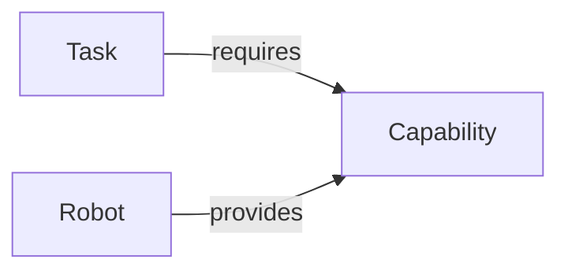
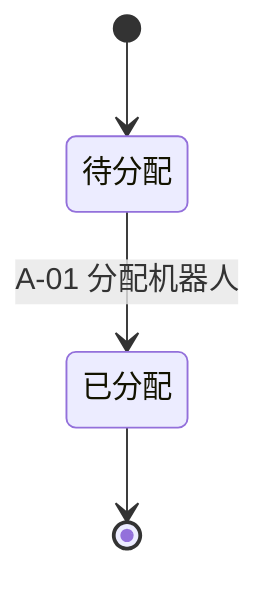

# Deliverables

The files of [`ontology-decomposition`](../SKILL.md), their formats, and the acceptance bar each must meet. All content is Chinese; IDs and Object identifiers stay as defined in `SKILL.md`.

| File | Asset | Written in step | Acceptance bar |
|---|---|---|---|
| `README.md` | 索引、版本、未决问题 | 2, updated every step | lists every file, the current version, every open question |
| `00-scope-and-scenarios.md` | 业务范围与场景 | 1-2 | user-confirmed |
| `01-semantic-dictionary.md` | 业务语义词典 | 3, extended in 4-6 | no ambiguity, no term defined twice |
| `02-object-catalog.md` | 领域对象清单 | 3 | each Object's responsibility is clear |
| `03-relation-graph.md` | 本体关系图 | 4 | every relation is explainable and traceable to a scenario |
| `04-behavior-model.md` | 动态行为模型 | 5-6 | the main business paths can be executed against it |
| `05-capability-matrix.md` | 系统能力映射矩阵 | 7 | ownership is clear, capability gaps are visible |
| `06-scenario-validation.md` | 场景验证矩阵 | 8 | typical normal and exception flows are covered |
| `07-gap-analysis.md` | 产品架构差异 | existing-system branch only | see [existing-system.md](existing-system.md) |

## README.md

```md
# {系统名} 本体模型

- 版本：v0.1（{YYYY-MM-DD}）
- 分支：新系统 / 现有系统改造

## 文件

- [业务范围与场景](00-scope-and-scenarios.md)
- …

## 未决问题

| # | 问题 | 影响的元素 | 需要谁回答 |
|---|---|---|---|

## 变更记录

| 版本 | 日期 | 变更 | 原因（哪个场景或检查触发） |
|---|---|---|---|
```

## 00-scope-and-scenarios.md

```md
# 业务范围与场景

## 业务目标

## 参与者

| 参与者 | 角色 | 与系统的交互 |
|---|---|---|

## 系统边界

| 范围内（系统管理） | 范围外（系统不管理） | 范围外部分的归属 |
|---|---|---|

## 能力问题清单

| ID | 问题 |
|---|---|
| CQ-01 | 哪些机器人现在能执行这张任务？ |

## 业务场景清单

| ID | 场景 | 类型 | 触发 | 参与者 | 业务结果 | 覆盖的能力问题 |
|---|---|---|---|---|---|---|
| S-01 | … | 正常 / 异常 / 跨系统 | … | … | … | CQ-01 |

### S-01 {场景名}

1. {步骤}
2. …

异常流程：S-02（第 2 步分配失败）、…

跨系统协作：{系统} — {第几步、交互内容}；没有则写「无」
```

## 01-semantic-dictionary.md

One row per term, across all seven categories. A term appears once; its synonyms go in 避免.

```md
# 业务语义词典

| 术语 | 标识 | 类别 | 定义 | 边界（不包括什么） | 避免 |
|---|---|---|---|---|---|
| 机器人 | Robot | 对象 | … | … | 设备、车 |
| 机器人已分配 | E-01 | 事件 | … | … | … |
```

类别 is one of 对象、属性、关系、类型、事件、行为、规则.

## 02-object-catalog.md

```md
# 领域对象清单

## Robot 机器人

- 层级：受管对象
- 定义：…
- 职责：…
- 身份标识：{两个实例在什么条件下算同一个}
- 类型体系：…
- 生命周期：{状态概览，详见 04}
- 实例示例：R-07、R-12

| 属性 | 含义 | 取值 / 单位 | 是否可变 |
|---|---|---|---|

## 参考对象

| 对象 | 定义 | 身份标识 | 关键属性 | 实例示例 | 归属（系统或角色） |
|---|---|---|---|---|---|
```

## 03-relation-graph.md

A Mermaid graph for the overview, then the dictionary that carries the six dimensions.

````md
# 本体关系图



## 关系字典

| ID | 源对象 | 语义 | 目标对象 | 种类 | 基数 | 约束 | 时间性 | 来源场景 |
|---|---|---|---|---|---|---|---|---|
| R-01 | Task | requires 需要 | Capability | 关联 | 多对多 | … | 当前 | S-01 |
````

种类 is one of 关联、继承、组合、依赖. 时间性 is 当前 or 历史.

## 04-behavior-model.md

````md
# 动态行为模型

## 状态模型

### TaskExecution 任务执行



| 状态 | 含义 | 允许的行为 | 是否终态 |
|---|---|---|---|

## 规则清单

| ID | 种类 | 规则 | 约束的元素 | 来源场景 |
|---|---|---|---|---|
| RULE-01 | 决策规则 | 能力不匹配禁止分配 | A-01、R-01 | S-01 第 2 步 |

## 行为

### A-01 分配机器人

- 作用对象：TaskExecution
- 前置条件：…（引用 RULE-xx）
- 执行行为：…
- 状态变化：待分配 → 已分配
- 产生事件：E-01 机器人已分配
- 异常与补偿：…

## 事件

| ID | 事件 | 含义 | 由哪个行为产生 | 携带的信息 |
|---|---|---|---|---|
````

种类 is one of 状态约束、不变量、决策规则.

## 05-capability-matrix.md

```md
# 系统能力映射矩阵

## 对象与行为的映射

| 本体元素 | 应用功能 | 服务 | API | 数据 | 现状 |
|---|---|---|---|---|---|
| Robot 机器人 | … | … | … | … | 已有 / 部分 / 缺口 |
| A-01 分配机器人 | … | … | … | … | … |

## 服务边界

| 服务 | 包含的对象与行为 | 划分依据（一致性 / 事务 / 团队职责 / 部署） |
|---|---|---|

## 能力缺口

| 缺口 | 影响的场景 | 建议 |
|---|---|---|
```

For a new system nothing exists yet, so 现状 is 规划 (a home is planned) or 缺口 (no planned home). An empty cell holds 缺口, or 不适用 with its reason (a reference Object needs no page).

## 06-scenario-validation.md

```md
# 场景验证矩阵

## 场景走查

| 场景 | 步骤 | 实例 | 对象 | 关系 | 规则 | 行为 | 事件 | 覆盖 |
|---|---|---|---|---|---|---|---|---|
| S-01 | 2 | R-07、T-123 | Robot、Task | R-01 | RULE-01 | A-01 | E-01 | 是 |
| S-02 | 3 | … | … | … | … | … | … | 缺口：{原因} |

## 能力问题验证

| ID | 问题 | 由哪些对象与关系回答 | 结论 |
|---|---|---|---|

## 冗余元素

| 元素 | 处理（删除 / 补充场景 S-xx） |
|---|---|

## 模型质量检查

| 检查项 | 结论 | 依据 |
|---|---|---|
| 完备性 | 通过 / 不通过 | … |
| 一致性 | | |
| 独立性 | | |
| 可组合性 | | |
| 可演进性 | | {假设的新场景，以及它迫使修改的元素数} |
```
