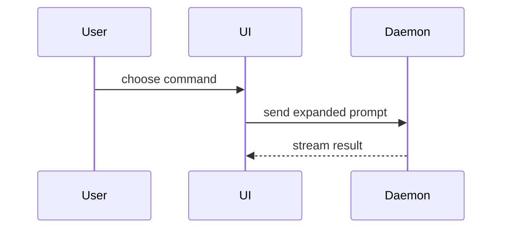

撰写 PR 正文时使用以下模板：

```markdown
## 概要

<示意图、diff 草图或树>

## 证据

- **改动前：** <截图 / 输出 / 失败的测试运行>
  **改动后：** <截图 / 输出 / 通过的测试运行>

## 合并风险

**能否低成本回滚：** <能 / 不能>

<可选：说明>

**影响范围：** <一个词概括>

<可选：合并后可能带来的影响>
```

本 skill 只负责正文怎么写。是否推送、是否创建 PR，仍按调用方和仓库规则取得确认。

## 各节写法

不写开场白，正文保持简短。领域词汇沿用 `GLOSSARY.md` 中的说法。

### 概要

选一个能把关键点说清楚的最小视图。

- 逻辑或算法，用伪代码：

```text
on(save)
  if content is unchanged
    return cached result
  write new content
  return fresh result
```

- 运行时控制流，用调用树：

```text
submitForm
  createSession
    persistPrompt
    launchAgent
  navigateToSession
```

- UI 结构，用组件树，标出重要的状态和模块边界：

```text
<SessionPage> (apps/example/src/routes/session.tsx)
  useSessionEvents()
  <SessionToolbar>
    <RunSkillButton> (packages/ui)
```

- 文件职责或大范围重构，用浅层文件树：

```text
src/
├── commands/       # 解析用户操作
├── sessions/       # 管理会话状态
└── transport/      # 发送 API 请求
```

- 组件交互、控制流或数据流，用 Mermaid：



- 重点在于"改了什么"、而周围结构已经存在时，用 `diff`。diff 的形式要和主题对应。

组件改动：

```diff
 <SessionPage>
   useSessionEvents()
   <SessionToolbar>
+    <RunSkillButton />
   <SessionTimeline>
+    <SkillResultCard />
```

文件布局改动：

```diff
 src/
 ├── commands/
+│   └── show-me.ts       # 展开斜杠命令
 ├── sessions/
-└── transport.ts
+└── transport/
+    ├── client.ts
+    └── stream.ts
```

调用树或调用栈改动：

```diff
 submitForm
   createSession
     persistPrompt
+    expandSkillMention
     launchAgent
-  navigateToSession
+  navigateToSession
+    subscribeToEvents
```

状态或控制流改动：

```diff
 on(save)
-  write content
+  if content is unchanged
+    return cached result
+  write new content
+  invalidate cache
```

- 以下情况贴出完整代码块：大部分内容是新增的；省略上下文会让归属或顺序看不清；读者需要一份可直接复制的目标形态。

```ts
function expandSkill(command: string): string {
  const skillName = command.slice(1);
  return `use the ${skillName} skill`;
}
```

#### 使用原则

每个可视化紧挨着它所支撑的那段简短文字。只保留回答读者当前问题、或解决当前讨论点所需的调用、文件、props、状态和边界。

可以用其中一种，也可以组合几种，一般不会全部用上。按改动的实际情况判断，不要让读者负担过重。

### 证据

给出改动有效的具体证据，并展示改动前后的对比。

改动涉及界面且环境支持截图时，截图是首选证据。

其次是基于执行的证据：测试结果、控制台输出。用伪代码写出那个改动前失败、改动后通过的测试。

### 合并风险

说明这次改动能否低成本回滚。容易回滚的 PR 风险较低；涉及破坏性操作或难以撤销的决定（如数据迁移、删除数据、对外发布的接口变更）的改动不能低成本回滚，需要明确写出。

影响范围是这个 PR 的改动可能波及的范围。把各种可能都考虑到，例如布局偏移、调用方出错、移动端适配等。
